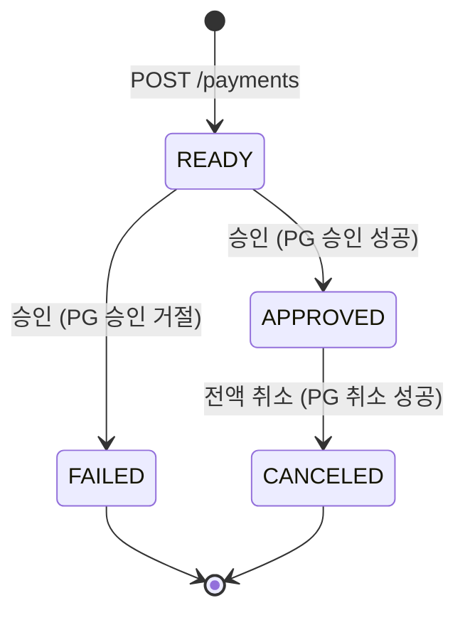

# Payment System

Java 25 + Spring Boot 4.1 + Gradle + PostgreSQL 기반 결제 시스템.

## 기술 스택

| 구분 | 버전 |
|---|---|
| Java | 25 (Temurin) |
| Spring Boot | 4.1.1 |
| Gradle | 9.8.0 (Wrapper) |
| PostgreSQL | 17 (Docker) |
| DB 마이그레이션 | Flyway |

## 프로젝트 진행 상황

### 체크리스트

**구현됨**

- [x] 프로젝트 기본 세팅: Java 25, Spring Boot 4.1.1, PostgreSQL 17, Flyway(`V1`~`V3`), Testcontainers
- [x] 결제 생성 `POST /payments`: READY 상태, KRW 고정, 금액은 `long`/`BIGINT`, 같은 `orderId`는 409
- [x] 요청 값 검증: `orderId` 비어 있지 않음·64자 이하, `amount` 양수 (실패 시 400)
- [x] 결제 조회 `GET /payments/{id}`, `GET /payments?orderId=` (없으면 404)
- [x] 결제 승인 `POST /payments/{id}/approve`: PG 승인 시 APPROVED, PG 거절 시 FAILED
- [x] 결제 전액 취소 `POST /payments/{id}/cancel`: PG 취소 성공 시에만 CANCELED, PG 거절 시 상태 유지 + 422
- [x] 상태 전이 검증: `Payment.approve()` / `fail()` / `cancel()`, 잘못된 전이는 409
- [x] PG 연동 경계: `PaymentGateway` 인터페이스 + `FakePaymentGateway`
- [x] 승인·취소 동시 처리 방지: 결제 행 잠금(`PESSIMISTIC_WRITE`)
- [x] 멱등성 키 `Idempotency-Key`: 생성·승인·취소에 적용, 요청 동시 처리는 advisory lock으로 직렬화
- [x] 오류 응답: 처리하는 예외와 Spring MVC 표준 예외를 ProblemDetail(RFC 9457) 형식으로 응답
- [x] 테스트 73개: 엔티티·서비스 단위, `@WebMvcTest`, `@DataJpaTest`, `@SpringBootTest` 통합, 동시성 (Testcontainers 사용)

**아직 안 한 일**

- [ ] 실제 PG 연동 (현재는 Fake: 승인은 1,000만 원 이하만 허용, 취소는 항상 성공)
- [ ] 부분 취소 (현재는 전액 취소만)
- [ ] PG 성공 후 DB 저장 실패 시 정합성 처리 (보상, 재시도, 대사)
- [ ] PG 거래 ID·거절 사유 저장 (DB에 컬럼 없음)
- [ ] 결제 상태 변경 이력 테이블
- [ ] 멱등성 키 만료·정리 (`idempotency_record`가 계속 쌓임)
- [ ] `orderId` 형식 검증 (현재는 길이만 검증)
- [ ] 처리되지 않은 예외(500)에 대한 공통 응답 핸들러
- [ ] API 문서화 (OpenAPI)
- [ ] 애플리케이션 로그 (메인 코드에 로깅 없음)

### 결제 상태 흐름

`PaymentStatus`는 READY, APPROVED, FAILED, CANCELED 네 가지이고, 전이는 `Payment` 엔티티가 검증합니다. FAILED와 CANCELED에서 나가는 전이는 없습니다.



### 요청 처리 구조

결제 생성·승인·취소(POST)는 `Idempotency-Key` 헤더가 있을 때만 `IdempotencyService`를 거칩니다. 조회(GET)와 헤더가 없는 요청은 곧바로 `PaymentService`로 갑니다. PG는 승인·취소에서만 호출됩니다.

```mermaid
flowchart TD
    Client([클라이언트]) --> Controller["PaymentController<br/>/payments"]

    Controller -- "GET, 또는 Idempotency-Key 없음" --> Service["PaymentService<br/>(@Transactional)"]
    Controller -- "POST + Idempotency-Key" --> Idem["IdempotencyService<br/>advisory lock, 응답 재사용"]
    Idem -- "처음 온 키: 실행" --> Service
    Idem <--> IdemDB[("PostgreSQL<br/>idempotency_record")]

    Service -- "생성·조회·상태 저장<br/>승인·취소는 행 잠금" --> Repo["PaymentRepository"]
    Repo <--> DB[("PostgreSQL<br/>payment")]
    Service -- "승인·취소만 호출" --> Gateway["PaymentGateway<br/>(FakePaymentGateway)"]

    Controller -. "예외 발생 시" .-> Handler["PaymentExceptionHandler<br/>IdempotencyExceptionHandler<br/>→ ProblemDetail (400/404/409/422)"]

## 사전 요구사항

- JDK 25
- Docker / Docker Compose

Gradle은 설치할 필요 없습니다. 저장소에 포함된 Wrapper(`gradlew`)를 사용합니다.

## 실행 방법

```bash
# 1. PostgreSQL 기동 (호스트 포트 5433)
docker compose up -d

# 2. 애플리케이션 실행
./gradlew bootRun --args='--spring.profiles.active=local'      # macOS/Linux
.\gradlew.bat bootRun --args='--spring.profiles.active=local'  # Windows

# 3. 헬스 체크
curl http://localhost:8080/actuator/health
```

> DB 포트를 5432가 아닌 **5433**으로 노출합니다. 로컬에 설치된 PostgreSQL과 충돌하지 않게 하기 위해서입니다.
> 바꾸려면 `DB_PORT` 환경변수를 docker compose와 앱 양쪽에 똑같이 지정하세요.

## 빌드 & 테스트

```bash
./gradlew build
```

테스트는 Testcontainers가 PostgreSQL 컨테이너를 자동으로 띄우므로 `docker compose`가 없어도 됩니다. Docker만 실행 중이면 됩니다.

## 환경 변수

| 변수 | 기본값 | 설명 |
|---|---|---|
| `DB_HOST` | `localhost` | DB 호스트 |
| `DB_PORT` | `5433` | DB 포트 |
| `DB_NAME` | `payment` | DB 이름 |
| `DB_USERNAME` | `payment` | DB 사용자 |
| `DB_PASSWORD` | `payment` | DB 비밀번호 |
| `SERVER_PORT` | `8080` | 애플리케이션 포트 |

## 프로젝트 구조

```
src/main/java/com/example/payment/
├── PaymentSystemApplication.java
├── idempotency/              # 멱등성 키 (서비스, 저장 엔티티, 예외 처리)
└── payment/                  # 결제 도메인 (엔티티, 리포지토리, 서비스, 컨트롤러, 예외 처리)
src/main/resources/
├── application.yml           # 공통 설정
├── application-local.yml     # 로컬 개발용 (SQL 로그 등)
└── db/migration/             # Flyway 마이그레이션 (V{n}__{설명}.sql)
```

## API

| 메서드 | 경로 | 설명 |
|---|---|---|
| POST | `/payments` | 결제 생성 (READY) |
| GET | `/payments/{id}` | 결제 조회 |
| GET | `/payments?orderId=` | 주문 ID로 결제 조회 |
| POST | `/payments/{id}/approve` | 결제 승인 (READY → APPROVED/FAILED) |
| POST | `/payments/{id}/cancel` | 결제 전액 취소 (APPROVED → CANCELED) |

취소는 PG가 취소에 성공했을 때만 CANCELED로 바뀝니다. PG가 거절하면 상태는 그대로 두고 422로 응답하며, 승인 상태가 아닌 결제(이미 취소된 결제 포함)를 취소하면 409로 응답합니다.

### 멱등성 키 (`Idempotency-Key`)

결제 생성·승인·취소는 `Idempotency-Key` 헤더(최대 64자)를 선택적으로 받습니다. 네트워크 오류로 재시도할 때 같은 키를 보내면 요청이 한 번만 처리됩니다.

- 같은 키로 같은 요청을 다시 보내면 처음 응답을 그대로 돌려줍니다(승인을 재시도해도 409가 아니라 처음의 200 응답).
- 같은 키로 **다른** 요청을 보내면 422로 거절합니다. 키가 비었거나 64자를 넘으면 400입니다.
- 같은 키의 동시 요청은 PostgreSQL advisory lock으로 직렬화되어, 먼저 끝난 요청의 응답을 재사용합니다.
- 요청 처리와 응답 저장은 한 트랜잭션입니다. 예외로 끝난 요청(404, 409, 422 등)은 저장하지 않으므로 같은 키로 다시 실행됩니다.
- 헤더를 생략하면 기존과 동일하게 동작합니다(예: 이미 승인된 결제를 다시 승인하면 409).

## 추후 계획

- **부분 취소**: 현재는 전액 취소만 지원합니다. 부분 취소를 하려면 누적 취소 금액 컬럼(Flyway 마이그레이션), 취소 요청 금액 검증(잔액 이내), 취소 이력 테이블이 필요하고, `PaymentGateway.cancel`에도 취소 금액이 전달되어야 합니다.

## 알려진 한계

- **PG 취소 성공 후 DB 저장 실패 (정합성 문제)**: PG 취소는 성공했는데 우리 DB의 상태 변경(CANCELED) 저장이 실패하면, PG에서는 취소됐지만 우리 DB에는 APPROVED로 남습니다. 현재는 보상 처리나 재시도, 대사(reconciliation)를 구현하지 않았습니다. 승인도 같은 구조입니다.
- **PG 호출 중 행 잠금 유지**: 승인·취소는 결제 행을 잠근 채 PG를 호출합니다. 중복 처리는 막지만, 실제 PG처럼 응답이 느리면 DB 연결과 잠금을 오래 점유합니다.
- **PG 거래 정보 미저장**: PG 거래 ID와 거절 사유를 DB에 저장하지 않습니다.
- **멱등성 키 보관 기간**: `idempotency_record`를 삭제하는 로직(TTL, 정리 배치)이 없어 계속 쌓입니다. 키를 일정 기간 뒤 만료시키는 정리 작업이 필요합니다.
- **PG 취소 거절은 재시도 시 PG를 다시 호출**: 거절(422)은 저장하지 않으므로 같은 키로 재시도하면 PG에 다시 요청합니다. 승인 거절은 결제가 FAILED가 되는 정상 응답(200)이라 저장됩니다.
- **Fake PG**: `FakePaymentGateway`가 연동되어 있습니다. 승인은 1,000만 원 이하만 허용하고 취소는 항상 성공합니다.

## 정리

```bash
docker compose down        # 컨테이너 중지
docker compose down -v     # 데이터 볼륨까지 삭제
```
